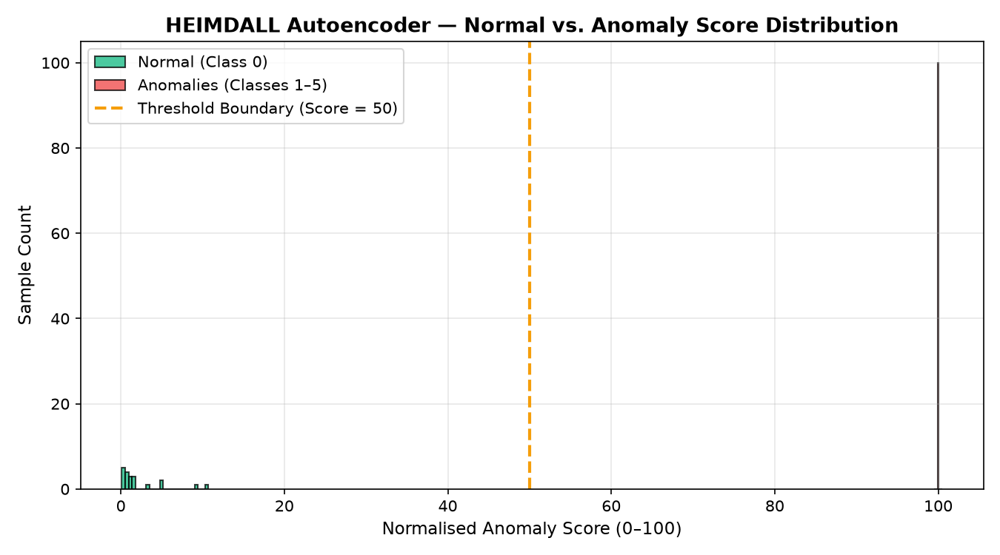
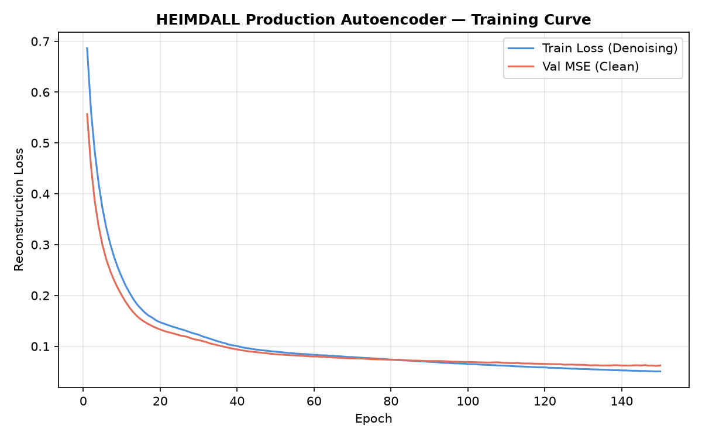

# HEIMDALL Autoencoder — Anomaly Detection Evaluation

## 1. Binary Classification Report (Normal vs. Anomaly)

```
                precision    recall  f1-score   support

    normal (0)     1.0000    1.0000    1.0000        20
anomaly (1..5)     1.0000    1.0000    1.0000       100

      accuracy                         1.0000       120
     macro avg     1.0000    1.0000    1.0000       120
  weighted avg     1.0000    1.0000    1.0000       120
```

- **Accuracy:** `1.0000`
- **Precision:** `1.0000`
- **Recall:** `1.0000`
- **F1-Score:** `1.0000`
- **ROC-AUC:** `1.0000`

## 2. Per-Class Anomaly Detection Breakdown

| Operating Class | Test Samples | Flagged as Anomaly (%) | Mean Anomaly Score (0–100) |
|-----------------|--------------|------------------------|----------------------------|
| `normal` | 20 | 0.0% | 2.3 / 100 |
| `cpu_stress` | 20 | 100.0% | 100.0 / 100 |
| `memory_pressure` | 20 | 100.0% | 100.0 / 100 |
| `disk_pressure` | 20 | 100.0% | 100.0 / 100 |
| `network_flood` | 20 | 100.0% | 100.0 / 100 |
| `system_anomaly` | 20 | 100.0% | 100.0 / 100 |

## 3. Public Server Machine Dataset (SMD) Benchmark Validation

- **Dataset:** `Server Machine Dataset (SMD machine-1-1, 38 metrics)` (1000 test steps, 38 server metrics)
- **ROC-AUC:** `1.0000`
- **Point-Adjusted F1-Score:** `0.9623`
- **Precision:** `0.9274`
- **Recall:** `1.0000`

## 4. Visualisations




