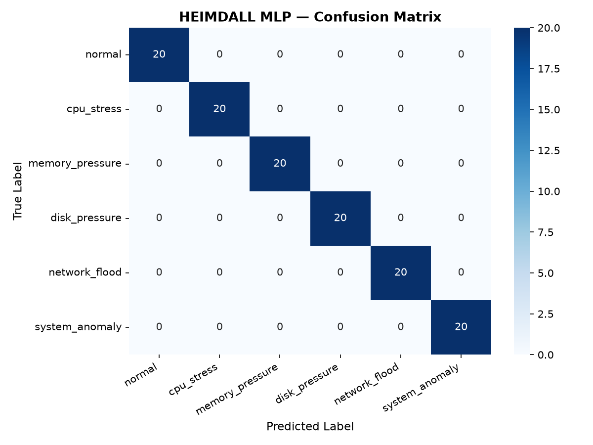
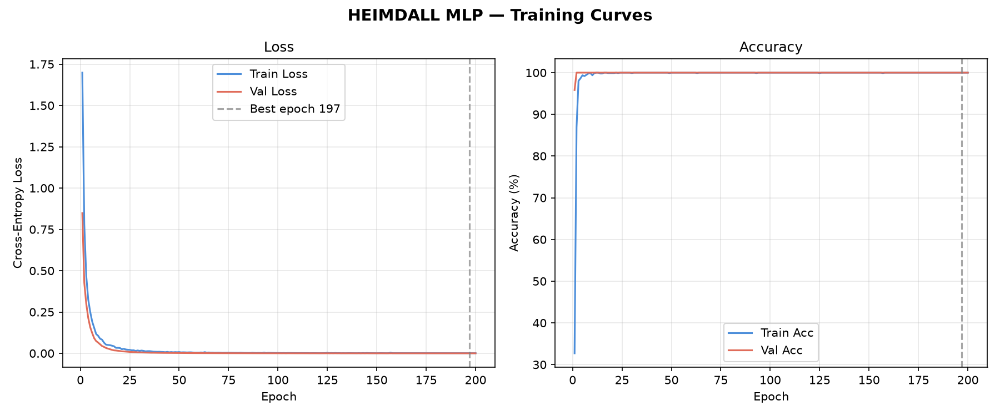

# HEIMDALL MLP — Evaluation Report
## Classification Report
```
                 precision    recall  f1-score   support

         normal     1.0000    1.0000    1.0000        20
     cpu_stress     1.0000    1.0000    1.0000        20
memory_pressure     1.0000    1.0000    1.0000        20
  disk_pressure     1.0000    1.0000    1.0000        20
  network_flood     1.0000    1.0000    1.0000        20
 system_anomaly     1.0000    1.0000    1.0000        20

       accuracy                         1.0000       120
      macro avg     1.0000    1.0000    1.0000       120
   weighted avg     1.0000    1.0000    1.0000       120
```

**Macro ROC-AUC:** 1.0000

## Confusion Matrix


## Training Curves

